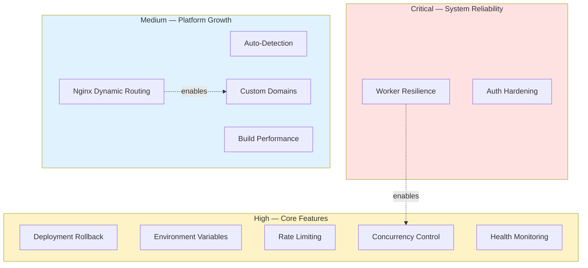

# Improvement Roadmap

> Actionable improvements organized by priority. Each item includes context on why it matters.
>
> Last checked against the code and the production host on 2026-11-27 (main `a653c24`). Newly found work is under [2026-11 review](#2026-11-review).

---

## Priority Overview

---

## Critical

### Worker Resilience

- [ ] Add dead-letter queue UI for manually retrying permanently failed jobs (owners already have a Retry button on FAILED deployments; admins have no view of failed BullMQ jobs)

> If the worker crashes mid-build, deployments stay in `BUILDING` forever.

### Auth Hardening

- [ ] Implement refresh token rotation (short-lived access + long-lived refresh)
- [ ] Revoke the session on logout. `tokenVersion` revocation exists, but logout only clears the cookies, so a stolen JWT works until it expires.
- [x] `httpOnly` and `secure` set consistently. The dashboard session is a host-only `__Host-auth-token` (#50). SameSite stays `Lax` on purpose, so links from email arrive signed in.
- [x] Tenant sites can't read, plant or clear the dashboard session (#50). Private sites use a separately keyed `site-view` cookie.

### Documentation

---

## High

### Deployment Rollback

- [x] Track `previousDeploymentId` on each deployment (as `rollbackOfId`, plus `imageTag` for the image each deployment ran)
- [x] Add `POST /api/projects/:id/rollback/:deploymentId` endpoint (at `POST /api/projects/:id/deployments/:deploymentId/rollback`)
- [x] Keep previous container available (tagged with version) until rollback window expires (images tagged `d-<deploymentId>`, last 3 kept)
- [x] Add rollback button in project detail UI

### WordPress Hosting

- [x] Relay app redirects (with their cookies) instead of following them in the proxy; move `127.0.0.1` locations onto the visitor's host
- [x] Raise the tenant request body limit to 64 MB (`experimental.proxyClientMaxBodySize`)
- [x] `WORDPRESS` project type: detection (`wp-content/`), UI, docs
- [x] Image: pinned WordPress core + repo `wp-content`, SQLite on the `/data` volume, Apache as `www-data` on 8080, 256 MB cap
- [x] New WordPress projects start private so nobody else can claim the install wizard
- [x] Consistent SQLite snapshot in `scripts/backup.sh`
- [ ] Sleep idle containers and wake them on the next request (all project types)
- [ ] Opt-in shared MariaDB for plugins that need MySQL

## AI

- [ ] Implement an AI code review with project code
- [ ] Implement an AI security check with project code (today only the blocked-package scanner in `package-scanner.ts` runs)

### Environment Variables

- [ ] Support `.env` file upload or paste (the panel adds one variable at a time)

### Rate Limiting & Resource Quotas

- [ ] Per-user deployment rate limit (e.g., 10/hour). `src/lib/rate-limit.ts` exists, but `/deploy` doesn't use it.
- [x] Limit 1 active deployment per project (queue subsequent triggers)
- [ ] Per-user container limit (e.g., 5 running containers). Today it's only capped indirectly by `projectQuota`, at one container per project.
- [ ] Auto-cleanup of deployments older than 30 days. Old images are pruned, but deployment rows and logs are never deleted.

### Deployment Concurrency Control

- [x] Cancel queued deployment UI

### Container Health Monitoring

- [ ] Add health check to generated Dockerfiles
- [ ] Poll container health status and expose in UI (only the admin drawer shows container state)
- [ ] Alert user when container is unhealthy or stopped

---

## Medium

### Build Performance

- [ ] Enable Docker BuildKit (`DOCKER_BUILDKIT=1`) for layer caching
- [ ] Cache `node_modules` and `pip` packages across builds via Docker volumes
- [ ] Support custom Dockerfile (user-provided in repo root). Today the generated Dockerfile overwrites the repo's own.

### Custom Domains

- [x] Add `CustomDomain` model with DNS validation state
- [x] Verification endpoint (TXT record, not CNAME)
- [x] Auto-provision SSL (Caddy `on_demand_tls` instead of certbot)
- [x] Generate Nginx config per custom domain (no longer needed: Caddy replaced Nginx)
- [x] Domain management UI with status indicators

### Database Resilience

- [ ] Connection pooling (PgBouncer or Prisma pool settings)
- [ ] Query timeout configuration
- [x] Automated daily backups (`scripts/backup.sh` + cron, see docs/deployment.md). Check that the cron runs on the production host: see [2026-11 review](#2026-11-review).

### Deployment History UI

- [x] Paginated deployment history per project
- [ ] Diff view between deployments

---

## Low

### Testing

- [ ] Unit tests for services (auth, deployment, docker, git). Partial: none for docker or git.
- [ ] Integration tests for API routes (partial)
- [ ] E2E test for full deploy flow (create → deploy → verify URL)
- [ ] CI pipeline (GitHub Actions) with test + type-check (there is no CI config at all)
- [ ] Test coverage tracking

### Team & Collaboration

- [ ] `Team` model with member roles (admin, developer, viewer)
- [ ] Project sharing with role-based permissions (partial: `ProjectAccess` grants viewing private sites only)
- [ ] Deployment approval workflow for production projects
- [ ] Activity feed showing team actions (partial: admin audit page only)

### Developer Experience

- [ ] `docker-compose.yml` for local dev (PostgreSQL + Redis)
- [x] Pre-commit hooks (lint + type-check) (opt-in: `npm run hooks:install`)
- [ ] `.devcontainer.json` for VS Code dev containers

### API & Integrations

- [ ] Webhook notifications for deployment events
- [x] GitHub webhook for auto-deploy on push
- [ ] GitLab auto-deploy on push
- [ ] Slack/Discord notification integration

### UI Polish

- [x] Onboarding wizard for first-time users
- [ ] Mobile responsiveness improvements
- [x] Global error boundary with retry

### Performance

- [ ] Redis caching for project list and detail queries
- [ ] HTTP cache headers (ETag, Cache-Control) on API responses (only static tenant files have them)
- [ ] Pagination on all list endpoints (`/api/projects` is not paginated)
- [x] Lazy-load deployment history and build logs

- [x] Show quota availability for users
- [ ] Monitoring architecture with Grafana etc. (today only the admin System page)
- [x] Plan the feature: drag and drop a project folder, zip file or single HTML file to deploy instantly

---

## 2026-11 review

Found on 2026-11-26 by checking `main` and the production host.

### Security: host settings (no code change)

- [ ] Review the production host against `scripts/harden-host.sh`, `scripts/split-web-user.sh` and `docs/deployment.md`, then redeploy all projects (`scripts/redeploy-all.ts`) so every container runs with the current limits. The details are tracked privately, not in this public repo.
- [ ] Bind Next to 127.0.0.1. First fix the tenant 404s that `next start -H 127.0.0.1` causes: `npm start` passes that flag, and the rewrite then loses the Host header.

### Reliability and operations

- [ ] Check that the daily backup cron runs on the production host, and keep a copy off the server
- [ ] Retire `en3.wtf`: remove `sites/legacy-domain.caddy` and the CLI fallback in `plugin/src/auth.ts`. Its DNS is already gone, and its certificate expires 2026-12-03.
- [ ] Remove unused Docker images (about 10 GB reclaimable)

### Email

- [ ] Request SES production access. In the sandbox only `@entrify.site`/`@entri.me` recipients get mail, at 1 per second. Until then, slow bulk invites (`SEND_GAP_MS` is 100 ms).

### Dependencies

- [x] Upgrade `next` to 16.4.6 and `zod` to 4.6.7 for the security advisories (#49)
- [ ] Static tenant files lost `Content-Length` on Next 16.4.5+. Serve static sites from Caddy `file_server` if file sizes matter.

### Deploys and running sites

- [ ] Run Django on gunicorn instead of `manage.py runserver` (Flask already uses gunicorn)
- [ ] Show students and mentors why a build failed (`buildStep`, or a short reason field)
- [ ] Make redeploy-all skip sites an admin stopped. `stoppedAt` now exists; see the `ponytail:` comment in `redeploy-plan.ts`.
- [ ] WebSocket support through the proxy (it strips `Upgrade`)

### Students and batches

- [ ] Filter `/explore` by batch, and add a batch column to the CSV exports
- [ ] Move a project between batches

---

## Quick Wins

High impact, achievable in a single session:

| # | Item | What to do |
|---|------|-----------|
| 1 | **Docker BuildKit** | Set `DOCKER_BUILDKIT=1` in worker env for faster builds (currently stripping BuildKit directives for classic builder compat) |
| 2 | **Django on gunicorn** | Copy the Flask template's gunicorn setup into the Django template |
| 3 | **Skip stopped sites in redeploy-all** | Add `stoppedAt` to `RedeployCandidate` and skip it in `redeploy-plan.ts` |
| 4 | **Backup cron** | Check the daily cron for `scripts/backup.sh` on the production host |
